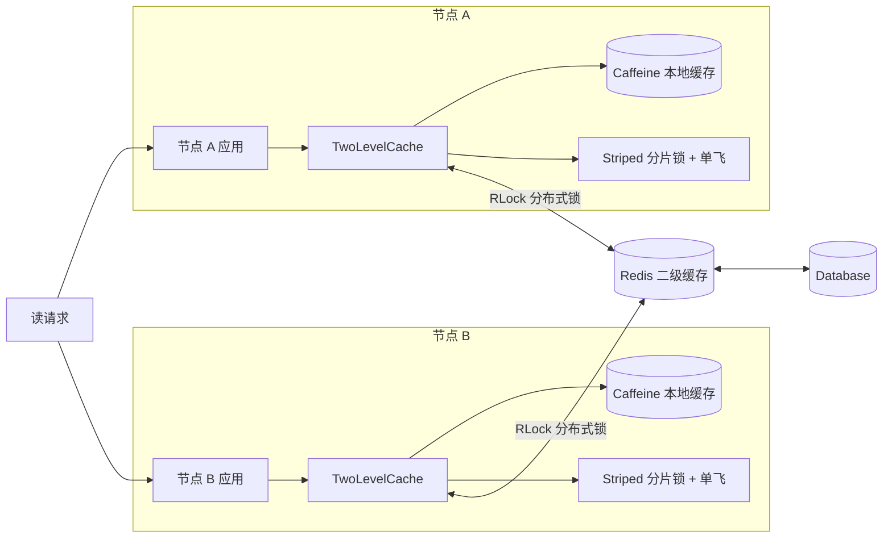
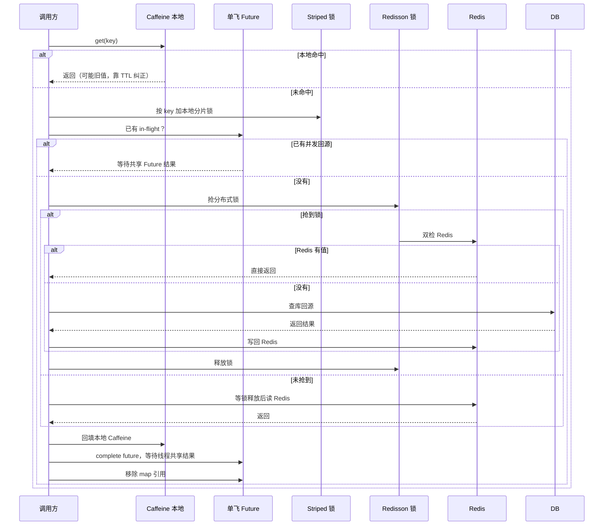

[Uploading README.md…]()
# Distributed Singleflight for Multi-Level Cache


多级缓存（Caffeine 本地 + Redis 远程）下，**读落空场景**的分布式单飞方案。用本地单飞 + Redisson 分布式锁，把回源同时收敛到 Redis 和 MySQL，避免并发回源打爆数据库。

> 核心思路：**本地未命中 → 单飞收敛 JVM 内并发 → 分布式锁收敛跨 JVM 并发 → 双检 Redis → 查库回填**。性能优先，接受短暂不一致，靠 TTL 控制窗口上限。

## 技术栈

- JDK 21
- Spring Boot 3.5.9
- Caffeine：本地一级缓存
- Guava Striped：本地分片锁
- Redisson：分布式锁
- Redis：二级缓存

## 目录

- [缘起](#缘起)
- [背景](#背景)
- [适用与不适用](#适用与不适用)
- [整体架构](#整体架构)
- [读时序图](#读时序图)
- [设计总结](#设计总结)
- [使用方式](#使用方式)
- [生产保障](#生产保障)
- [已知边界](#已知边界)
- [常见问题 FAQ](#常见问题-faq)
- [项目结构](#项目结构)
- [License](#license)

## 缘起

相信不少同学在做多级缓存时都遇到过这样的问题：本地 Caffeine 加了，Redis 也配了，读写看起来没问题，但**本地缓存命中旧值、并发回源打爆数据库**这两个坑，总会在某个时刻冒出来。

作者在实际项目中也遇到了同样的困扰，查阅了 JetCache 等主流方案后发现，它们覆盖了本地失效广播、JVM 内穿透保护、自动刷新这些能力，但**跨 JVM 的回源收敛**——也就是多个节点同时缓存落空、同时打 Redis 和 DB 的场景——并没有现成的保护。

于是一系列思考由此展开。

**最初的设想**：能不能让**读和写共用同一个 future**？写先加锁再进单飞，读先单飞再加锁，读写通过同一个 future 协调，理论上可以保证"写更新后，读回源一定能拿到新值"，彻底消除旧值覆盖。

**推演后否掉了**。问题出在读写互相阻塞上：

- **写等读**：写要先抢锁，而锁可能被读回源持有着（读回源在锁内查库、写 Redis，耗时不可控）。高并发读场景下，写可能长时间抢不到锁，**被读饿死**。
- **读等写**：读回源要等写事务提交、释放锁之后才能进单飞，读响应被写阻塞，**延迟不可控**。
- **互相等待形成风险**：一旦读写共用同一把锁 + 同一个 future，等待关系变得复杂，容易出现"读等写释放锁、写等读完成 future"的循环依赖，**引入不可控的死锁和饥饿风险**。

**权衡后放弃**：读写协同听起来很美，但代价是**把读写耦合进同一条串行链路**，高并发下性能不可控、风险太大。相比之下，**只做读落空场景的收敛，不碰写路径**，虽然保留了"旧值覆盖"这个固有代价，但它有 TTL 兜底、有明确上限，比"读写互相阻塞"可控得多。

**最终方案**：本地单飞收敛 JVM 内并发 + Redisson 分布式锁收敛跨 JVM 并发 + 双检 Redis 避免重复查库。**只解决读落空时的回源击穿，写路径不参与锁**，接受短暂不一致，靠 TTL 控制窗口。

本文完整记录了这个思考过程、每一步的取舍、以及固有代价。希望能给遇到同类问题的读者带来一些思路和启发。

## 背景

多级缓存能扛住高并发读，但**读落空时会引入两个问题**：

1. **同 JVM 内并发回源重复**：本地未命中，大量线程同时去查 Redis / DB。
2. **跨 JVM 并发回源打爆 DB**：多节点同时未命中，各自回源，DB 被集中打一波。

本项目只针对**读落空场景**，用两层单飞把回源并发收敛到全局 1，同时保护 Redis 和 MySQL。

## 适用与不适用

### 适用

- 读多写少
- 可容忍秒级延迟（不要求强一致）
- 分 key 的缓存场景

### 不适用

- 写频繁：本地缓存反复失效，命中率崩盘，应直接读 Redis/DB
- 强一致要求：本方案接受失效窗口内的旧值，靠 TTL 控制窗口上限

## 整体架构



## 读时序图



**流程**：

1. **本地命中**：直接返回，可能旧值，靠 TTL 纠正。
2. **本地未命中**：进入本地单飞，同 JVM 内只出一个线程，其他线程共享 future。
3. **本地单飞线程**：抢分布式锁，跨 JVM 只让一个节点回源。
4. **双检 Redis**：抢到锁后先查 Redis，有值直接返回，避免重复查库。
5. **Redis 也落空**：查库 → 写 Redis → 释放分布式锁。
6. **回填本地**：写 Caffeine，complete future，等待线程共享结果。
7. **移除 future 引用**：下一轮读重复上述流程，此时 Redis 大概率有值，单飞共享到 Caffeine 即可。

## 设计总结

### 根本矛盾：CAP 不可兼得

多级缓存绕不开一个根本矛盾：**一致性、可用性、性能，三者不可同时满足。**

- 要**强一致**：必须串行化读写，代价是写被读阻塞、MVCC 失效、吞吐崩盘，高并发下写可能被饿死。
- 要**高性能**：必须允许读写并发，代价是短暂不一致——本地副本、Redis 回填都可能短暂存旧值。

**没有两全的方案，只有取舍。** 本方案选择性能优先，接受短暂不一致，靠 TTL 把窗口压到有上限。

### 本文切入角度

既然一致性无法完美，本文就**不追求强一致，而是聚焦一个具体问题**：读落空时，多个节点同时回源，把 Redis 和 DB 打爆。

切入方式是：**本地单飞收敛 JVM 内并发 + Redisson 分布式锁收敛跨 JVM 并发 + 双检 Redis 避免重复查库**。只做读落空这一条路径，不碰写路径，不追求强一致，把问题收敛到可控范围。

### 每一步解决的问题与代价

- **本地单飞**：解决同 JVM 内并发回源重复。代价是等待线程阻塞，需超时降级。
- **本地分片锁**：解决同 JVM 内按 key 串行。代价是分片数需权衡配置（多了内存占用高，少了锁竞争大）、锁实例懒创建且弱引用可回收，**使用期间必须强引用锁对象**，否则被 GC 回收后同一 key 可能拿到不同锁实例。
- **Redisson 分布式锁**：解决跨 JVM 回源收敛。代价是锁竞争、看门狗续期、持有者宕机。
- **双检 Redis**：解决锁内重复查库。

### 固有代价：旧值覆盖新值

读回源与写并发交错时，可能出现"回源旧值覆盖写更新"。这是缓存与 DB 无法原子更新的固有代价，JetCache 同样存在。

**不能为了防它去串行化读回源和写**：写会被读阻塞，高并发下写可能被饿死，比脏一个 TTL 窗口严重得多。

**处理方式**：接受短暂旧值覆盖，靠 TTL 兜底，把窗口压到有上限。这是性能优先的工程取舍，不是设计缺陷。

### 分布式锁只保护读回源

分布式锁**只用于"读回源的 Redis 写入"**，**写路径不参与**。如果让写也抢这把锁，写事务持锁期间读回源全被堵，等于把数据库 MVCC 的读写解耦废掉，写可能被读饿死。

### 为什么分布式锁不是瓶颈

进锁的路径只有"读未命中单飞"。稳态下读请求绝大多数走本地命中，不碰锁。锁的 QPS 远低于读 QPS。

## 使用方式

### 读：本地 → Redis → DB，单飞收敛回源

```java
Object value = twoLevelCache.get("article:" + id,
        () -> articleMapper.selectById(id));
```

### 完整示例：ArticleService

```java
@Service
@RequiredArgsConstructor
public class ArticleService {

    private final TwoLevelCache twoLevelCache;

    public String getArticle(Long id) {
        String key = "article:" + id;
        Object value = twoLevelCache.get(key, () -> {
            // 真实场景替换为 articleMapper.selectById(id)
            return "article-content-" + id;
        });
        return value == null ? null : value.toString();
    }
}
```

### 缓存键与 TTL 设计

| 参数 | 建议 | 说明 |
|---|---|---|
| 本地 TTL | 10s ~ 60s | 脏数据窗口上限，越小越实时，越大命中率越高 |
| Redis TTL | 10m ~ 30m | 二级缓存兜底，防 Redis 长期存旧值 |
| 缓存键 | `业务:ID`（如 `article:123`） | 按业务域分 key，避免全局失效风暴 |

建议：

- 不同数据按**实时性要求**配置不同 TTL，不要一刀切。
- 热点 key 可单独调大本地 TTL 与容量上限。
- 键中带上业务前缀，便于排查与批量失效。

### 配置示例

```yaml
spring:
  application:
    name: distributed-cache-singleflight

  data:
    redis:
      host: 127.0.0.1
      port: 6379
      password:
      database: 0
      timeout: 3000ms
      lettuce:
        pool:
          max-active: 16
          max-idle: 8
          min-idle: 2
          max-wait: 3000ms

# Redisson 自动装配读取 spring.data.redis，无需额外配置
cache:
  two-level:
    local-max-size: 10000
    local-ttl-seconds: 300
    redis-ttl-seconds: 1800
    local-lock-stripes: 1024
    single-flight-timeout-seconds: 3
```

## 生产保障

### 容错与降级

| 故障场景 | 表现 | 降级行为 |
|---|---|---|
| Redis 不可用 | 分布式锁失效 | 直接查库，功能可用，性能下降 |
| 分布式锁持有者宕机 | 锁不释放 | Redisson 看门狗续期 + 锁超时自动释放 |
| 单飞等待超时 | 等待线程超时 | 降级自行回源 |

### 监控与指标

| 指标 | 含义 |
|---|---|
| 本地命中率 | Caffeine 命中 / 总读，稳态应 > 90% |
| 回源 QPS | 打到 DB 的 QPS，应远低于读 QPS |
| 锁等待耗时 | 分布式锁排队时间，异常升高说明回源竞争激烈 |

## 已知边界

- **本地缓存失效窗口内读到旧值，是设计允许的**，靠 TTL 控制上限。
- **读回源与写并发交错时，Redis 可能短暂存旧值**。这是缓存与 DB 无法原子更新的固有代价，靠 TTL 兜底，不追求强一致。
- **强一致场景不适用**。强一致必须串行化读写，代价是写被读阻塞、MVCC 失效、吞吐下降。
- 依赖 Redis 可用性；Redis 不可用时分布式锁失效，降级为直接查库。

## 常见问题 FAQ

**Redis 不可用时为什么还能用？**
分布式锁失效后，读路径直接查库并回填本地，功能可用、性能下降，不会雪崩。

**旧值覆盖新值怎么处理？**
接受它，靠 TTL 兜底。不能为了防它去串行化读回源和写，否则写会被读阻塞，高并发下可能被饿死。

**这个方案能保证强一致吗？**
不能。强一致要求串行化读写，代价是写被读阻塞、MVCC 失效。本方案选择性能优先，接受短暂不一致。

## 项目结构

```
src/main/java/com/zgw/distributed/cache/singleflight/
├── SingleFlightApplication.java
├── config/
│   ├── CacheProperties.java
│   └── TwoLevelCacheAutoConfiguration.java
├── core/
│   └── TwoLevelCache.java
└── example/
    └── ArticleService.java
```

## License

[MIT](LICENSE)
